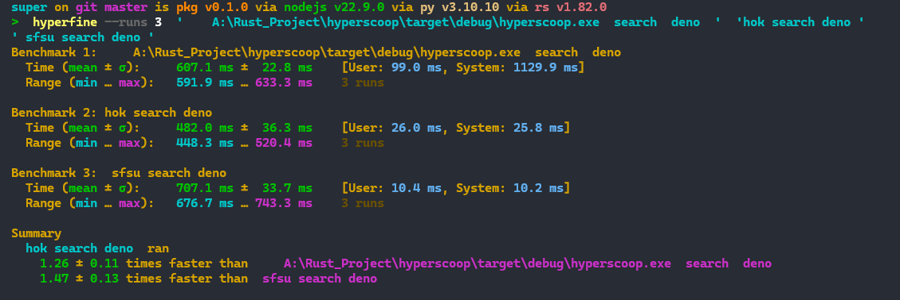
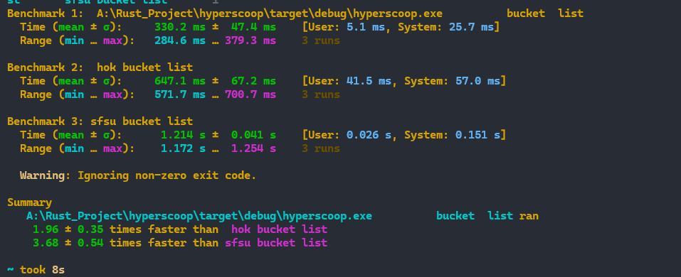

# Changelog

## 4.5.6 (2026-10-26)

- 修复 aria2 半成品及原生 HTTP 回退被误判为完整缓存的问题，分离下载中与已完成文件并保留旧版续传状态。
- 增加下载文件锁和清理互斥，保留现有 Scoop 缓存命名及完整缓存复用。
- 增加 `hp cache prune --days <天数>`、`hp cache rm -n` 预览与默认 120 天的定期自动清理。
- 更新中英文 README，说明缓存状态、清理配置与 `hp cleanup` 的实际范围。

## 1.0.4 (2024-11-10)

- 壮举   : 完成search命令的实现
  

---

## 1.0.3 (2024-11-5)

- 壮举 : 完成List命令
  

## 1.0.2 (2024-11-3)

- 完成bucket命令和merge命令
  

---

## 1.0.1 (2024-10-27)  初始化CLI

### [0.1.0]

    *2024/10/27 初始化hyperscoop和 manifest*

--- 

### [0.1.1]   *2024/10/27 增加了一些功能*  

